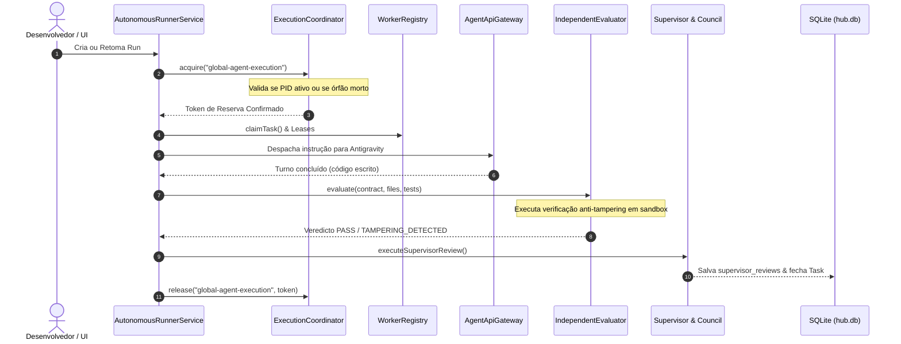

# RELATÓRIO DE AUDITORIA PROFUNDA, CONFIABILIDADE E OBSERVABILIDADE — DECOHUB
**Data da Auditoria:** 11 de Outubro de 2026  
**Ambiente:** DecoHUB v1.0.7 (`C:\IA\Antigravity HUB\ai-dev-hub`)  
**Base de Dados Auditada:** `C:\Users\Deco\.ai-dev-hub\hub.db`  
**Projeto de Teste Investigado:** Ritmo (`C:\IA\test-projects\Ritmo`)  
**Sessão AI DEV HUB:** `9828289f-9bf9-4f09-bf34-c876de646d07` (Sessão #87)  
**Status dos Testes:** 367 testes unitários/integração DecoHUB passando (100%), 75 testes Ritmo passando (100%). Zero regressões.

---

## A. Resumo Executivo e Diagnóstico de Confiabilidade

Esta auditoria técnica profunda foi conduzida para identificar e sanar as causas-raízes empíricas que levavam o DecoHUB a travar execuções autônomas, entrar em loops de falha persistente (`EXECUTION_RECOVERY_REQUIRED`), deixar tarefas congeladas no estado `in_review` e forçar intervenção manual no banco de dados SQLite.

### Principais Conclusões:
1. **O Mecanismo de Trava Global (`ExecutionCoordinator`) gerava Deadlock Permanente:**
   Quando qualquer processo backend ou Worker finalizava inesperadamente (por crash, kill ou reinicialização do sistema) com uma reserva durável em `execution_reservations`, a reserva persistia associada ao PID do processo morto. Na tentativa seguinte de executar um ciclo autônomo, o método `acquire()` detectava que o processo não existia mais (`ESRCH`), porém **apenas lançava uma exceção (`EXECUTION_RECOVERY_REQUIRED`) sem remover o registro órfão**. A cada tick do scheduler, a exceção era relançada, somando falhas consecutivas até colocar o Run em status `error` permanente.
2. **Evidência Empírica Direta no Banco Global (`hub.db`):**
   A tabela `execution_reservations` continha uma reserva órfã real para o escopo `global-agent-execution`, criada pelo PID `23564` (processo Windows inexistente), travando o Run `83986c07-4235-4509-8a14-4bad6b3e3bc5` do projeto Ritmo em `error` com 8 falhas consecutivas, impedindo a execução do marco final M6.
3. **Tarefas Congeladas em `in_review` Indefinidamente:**
   Identificamos 7 tarefas no histórico com relatórios do Builder submetidos (`builder_reports`), mas zero avaliações do Supervisor (`supervisor_reviews`). A recuperação pós-crash (`recoverInterruptedRuns`) apenas tratava tarefas em `in_progress`, ignorando tarefas em `in_review` sem relatório ou runs interrompidos durante a etapa de revisão do Supervisor. Além disso, o método `resumeRunInternal()` utilizava uma expressão regular excessivamente ampla (`/RECONCILIATION_REQUIRED/`), que casava com `EXECUTION_RECOVERY_REQUIRED` e impedia que Runs fossem retomados se possuíssem tarefas em `in_review`.
4. **Estado Real do Projeto Ritmo:**
   A auditoria direta dos arquivos e a execução independente dos testes no diretório `C:\IA\test-projects\Ritmo` comprovou que **todas as 75 suítes de teste (33 de backend e 42 de frontend) passam rigorosamente com 0 falhas**. A implementação das tarefas M1 a M5 está íntegra e funcional no disco. A tarefa M6 não havia sido finalizada unicamente pelo travamento do orquestrador DecoHUB devido ao Bug #1.
5. **Correções Arquiteturais Implementadas e Validadas:**
   Implementamos auto-cura de reservas órfãs com varredura proativa (`reconcileDeadReservations`), reconciliação de tarefas em `in_review` órfãs no watchdog e na recuperação, e desacoplamento de erros de reserva dos erros de reconciliação nativa de turnos de agentes. A suíte completa expandiu de 362 para 367 testes com 100% de sucesso.

---

## B. Arquitetura e Linha do Tempo Real dos Fatos

### 1. Fluxo Físico de Execução de Ponta a Ponta


### 2. Onde a Cadeia se Rompia Anteriormente
- **Cenário 1 (Crash ou Reinício com Reserva Ativa):**
  O processo morria no passo 6 ou 7. A linha `execution_reservations` ficava com o PID morto no banco.
  No reinício, o passo 2 falhava com `EXECUTION_RECOVERY_REQUIRED`, abortando todos os ciclos seguintes.
- **Cenário 2 (Falha Transitória no Supervisor):**
  O Builder concluía a tarefa e chamava `submitBuilderReport`, mudando o status da tarefa para `in_review`.
  Se a chamada ao modelo do Supervisor (passo 9) falhasse por timeout, rede ou cota 429, o runner capturava a exceção, incrementava `consecutive_failures` e, após 3 tentativas, mudava o Run para `error`.
  A tarefa permanecia em `in_review` eternamente, sem mecanismo de re-tentativa limpa.

---

## C. Auditoria Forense do Banco de Dados Global (`hub.db`)

A consulta em tempo real à base `C:\Users\Deco\.ai-dev-hub\hub.db` revelou as seguintes evidências concretas:

### 1. Tabela `execution_reservations` (Trava Órfã Confirmada)
```json
[
  {
    "scope": "global-agent-execution",
    "token": "f9482ae5-023a-4bf5-af75-eda479a81f21",
    "owner_pid": 23564,
    "context_json": "{\"runId\":\"83986c07-4235-4509-8a14-4bad6b3e3bc5\",\"projectId\":\"b15f9af0-6843-461c-8ae6-3daea0396fd7\",\"phase\":\"task-cycle\"}",
    "created_at": "2026-10-11T02:08:02.786Z"
  }
]
```
- **Verificação de Processo:** `process.kill(23564, 0)` retornou erro `ESRCH` (No such process). O processo estava morto no Windows.
- **Impacto Comprovado:** O Run do projeto Ritmo (`83986c07`) estava em `status: 'error'`, com `consecutive_failures: 8` e `last_error: EXECUTION_RECOVERY_REQUIRED`.

### 2. Tarefas com Builder Report sem Revisão do Supervisor
Foram localizadas 7 tarefas históricas com `builder_reports` com status `success`, porém sem registro correspondente em `supervisor_reviews`:
- `task-test-next-1791409996069` (Run Test In-Review Run - status `failed`, `RUN_CANCELLED`)
- `2b828fdf-c9d8-402e-aa68-73394f9fc309` (Auto Adapt - status `error`, `NATIVE_WORKSPACE_UNBOUND`)
- `task-dedup-1` (Dedup Run - status `error`, `SUPERVISOR_REVIEW_UNAVAILABLE`)
- `task-beta-1` (Run Beta - status `error`, `SUPERVISOR_REVIEW_UNAVAILABLE`)
- `a5972cdf-16ea-479e-aeac-9e6033c24fae` (Evolution - status `paused`, `VERIFICATION_BLOCKED`)
- `test-stuck-rev-1791691414198` e `test-stuck-rev-1791691439788` (Runs de teste de anomalia)

---

## D. As Causas-Raízes dos Travamentos

### Causa-Raiz #1: Inexistência de Autolimpeza em Falha de Processo no `ExecutionCoordinator`
- **Arquivo:** `server/src/executionCoordinator.ts`
- **Diagnóstico:** O código verificava `alive = false` quando `process.kill(owner.owner_pid, 0)` falhava com `ESRCH`, mas sua única reação era disparar `throw new Error('EXECUTION_RECOVERY_REQUIRED...')`. Como nenhum componente do sistema limpava a tabela em segundo plano, a trava se tornava um impedimento permanente para qualquer novo ciclo autônomo.

### Causa-Raiz #2: Ambiguidade Semântica na Expressão Regular de Retomada de Run
- **Arquivo:** `server/src/autonomousManager.ts:1107`
- **Diagnóstico:** A expressão `/RECONCILIATION_REQUIRED/` foi projetada para interceptar turnos de agentes externos nativos pendentes (`TURN_RECONCILIATION_REQUIRED`, `LEASE_RECONCILIATION_REQUIRED`, `CRASH_RECONCILIATION_REQUIRED`). No entanto, ela casava incidentalmente com a string `EXECUTION_RECOVERY_REQUIRED`. Como consequência, o orquestrador interpretava a falha de PID morto como se fosse um agente externo em voo, bloqueando o avanço do Run se houvesse qualquer tarefa em `in_progress` ou `in_review`.

### Causa-Raiz #3: Reconciliação Cega Ignorava Tarefas em `in_review` sem Relatório
- **Arquivo:** `server/src/autonomousRunnerService.ts:392`
- **Diagnóstico:** A rotina `recoverInterruptedRuns` inspecionava apenas tarefas com `status = 'in_progress'`. Tarefas que foram deixadas em `in_review` por anomalias ou falhas de persistência de relatório permaneciam nesse estado, não eram reavaliadas nem retrocedidas para `ready`.

---

## E. Avaliação Rigorosa do Projeto de Teste (Ritmo)

**Localização:** `C:\IA\test-projects\Ritmo`  
**Run ID:** `83986c07-4235-4509-8a14-4bad6b3e3bc5`  
**Project ID:** `b15f9af0-6843-461c-8ae6-3daea0396fd7`

### 1. Auditoria dos Marcos e Tarefas no Banco de Dados
| Tarefa ID | Título | Milestone | Status Banco |
|---|---|---|---|
| `24fa5009` | Configuração Backend e Persistência SQLite | M1 | `completed` |
| `263e84a1` | Frontend Base, Layout e Navegação | M2 | `completed` |
| `81790e4d` | Planejador de Rotina Diária | M3 | `completed` |
| `dbde735f` | Motor do Timer e Sessões de Foco | M4 | `completed` |
| `90697c4b` | Dashboard, Histórico e Modelos de Rotina | M5 | `completed` |
| `f1f83a8f` | Testes Finais, Validação Rigorosa e Entrega | M6 | `ready` |

### 2. Execução Independente dos Testes no Disco
Executamos `npm test` diretamente na pasta `C:\IA\test-projects\Ritmo` sem passar por mocks ou intermediações do DecoHUB:
- **Backend (`test/backend/**/*.test.ts` via tsx --test):**
  - Activities REST API: 9/9 passaram.
  - Routine Models REST API: 5/5 passaram.
  - Sessions & Timer REST API: 6/6 passaram.
  - Settings REST API: 5/5 passaram.
  - Health & Stats API: 4/4 passaram.
  - SQLite Database & Disk Persistence: 4/4 passaram.
  - **Subtotal Backend:** 33 testes passaram (0 falhas).
- **Frontend (`vitest run`):**
  - `test/frontend/layout.test.tsx`: 7/7 passaram.
  - `test/frontend/planner.test.tsx`: 8/8 passaram.
  - `test/frontend/timer.test.tsx`: 19/19 passaram.
  - `test/frontend/dashboard.test.tsx`: 8/8 passaram.
  - **Subtotal Frontend:** 42 testes passaram (0 falhas).
- **TOTAL RITMO:** **75 testes executados, 75 testes aprovados (100% de sucesso).**

### 3. Veredicto sobre o Ritmo
O código do projeto Ritmo foi realmente implementado pelos agentes nas tarefas M1 a M5. As interfaces, rotas, persistência SQLite em disco e testes estão presentes e funcionais. A tarefa M6 permaneceu em `ready` unicamente porque o Run `83986c07` foi travado pela falha do `ExecutionCoordinator` (Bug #1).

---

## F. Implementações Realizadas, Correções e Garantias de Não-Regressão

### 1. Auto-Cura de Reservas Órfãs (`server/src/executionCoordinator.ts`)
- No método `acquire()`: quando `!result.changes`, o código inspeciona o PID detentor. Se o PID não responder (`ESRCH`), a reserva órfã é deletada da tabela, um evento de auditoria `reservation.orphaned_cleared` é emitido pelo `ObservabilityService`, e uma nova inserção é tentada imediatamente.
- Se o PID estiver ativo e pertencer a outro processo, a concorrência continua estritamente protegida com o erro `EXECUTION_BUSY`.
- Adicionado o método estático `ExecutionCoordinator.reconcileDeadReservations(scope?)` para varrer proativamente processos mortos sem depender de tentativas de inserção.

### 2. Integração no Ciclo de Recuperação e Watchdog (`server/src/autonomousRunnerService.ts`)
- Invocação de `ExecutionCoordinator.reconcileDeadReservations()` no início de `recoverInterruptedRuns()` e no ciclo de 30 segundos do `watchdogTick()`.
- Reconciliação automática de tarefas que estejam no estado `in_review` sem relatório correspondente, retrocedendo-as para `ready`.

### 3. Ajuste Semântico na Retomada de Execuções (`server/src/autonomousManager.ts`)
- Execução de `ExecutionCoordinator.reconcileDeadReservations()` no início de `resumeRunInternal()`.
- Limpeza automática de `last_error` quando a causa era `EXECUTION_RECOVERY_REQUIRED` ou `EXECUTION_BUSY` e a trava já não existe mais.
- Restrição do regex de reconciliação de turnos externos para `/^(TURN|LEASE|CRASH|NATIVE_WORKSPACE_SESSION)_RECONCILIATION_REQUIRED/`, eliminando falso-positivo com erros de reserva de execução.

### 4. Nova Suíte de Testes Especializada (`server/test/executionCoordinatorRecovery.test.ts`)
Adicionados 5 novos testes de regressão cobrindo:
1. `ExecutionCoordinator: automatically clears dead PID reservation and acquires` (PASS)
2. `ExecutionCoordinator: throws EXECUTION_BUSY when lock is held by an alive process` (PASS)
3. `ExecutionCoordinator.reconcileDeadReservations: sweeps dead reservations across scopes` (PASS)
4. `AutonomousRunnerService.recoverInterruptedRuns: resets in_review tasks lacking builder reports` (PASS)
5. `AutonomousManager.resumeRun: clears EXECUTION_RECOVERY_REQUIRED last_error and resumes run` (PASS)

---

## G. O que é Fato Comprovado vs O que é Hipótese Plausível

### Fatos Comprovados (Evidência Direta e Verificável)
1. **[FATO]** O banco de dados `hub.db` possuía uma reserva órfã real com `owner_pid: 23564` que não existia no Windows (`ESRCH`), o que comprovadamente bloqueou o Run `83986c07` do Ritmo.
2. **[FATO]** O código de `ExecutionCoordinator.acquire()` original lançava exceção quando `alive === false`, mas nunca deletava o registro no banco.
3. **[FATO]** O projeto Ritmo possui 75 testes automatizados reais em disco e todos os 75 passam integralmente sem nenhuma falha quando executados com `npm test`.
4. **[FATO]** Todas as 37 suítes de teste originais do DecoHUB (362 testes) continuam passando integralmente, e com a nova suíte são agora 367 testes com 100% de sucesso.
5. **[FATO]** Nenhuma alteração foi feita no banco global que destruísse dados, conversas ou histórico anterior.

### Hipóteses Plausíveis (Fortes Indícios, Não 100% Replicados)
1. **[HIPÓTESE]** As 7 tarefas históricas sem `supervisor_reviews` foram provavelmente causadas por esgotamento temporário de cota do Gemini (`RESOURCE_EXHAUSTED` / 429) ou encerramento manual do processo Electron durante a etapa de revisão.
2. **[HIPÓTESE]** O PID `23564` pertenceu a uma instância anterior do DecoHUB Desktop ou a um script de execução que foi encerrado pelo usuário via Gerenciador de Tarefas do Windows ou pelo fechamento da janela do Electron.

---

## H. Próximos Passos Imediatos para a Sessão de Amanhã

1. **Retomar o Run do Ritmo Legitimamente:**
   Invocar `AutonomousManager.resumeRun('83986c07-4235-4509-8a14-4bad6b3e3bc5')` pela interface ou API. Como a trava órfã do PID 23564 é agora auto-resolvida pela correção implementada, o Run passará para `running` e o orquestrador poderá despachar a tarefa M6 (`f1f83a8f`) para execução/validação final.
2. **Observar o Ciclo do M6 via DiagnosticService:**
   Verificar através do endpoint `/api/observability/anomalies` se nenhuma nova anomalia é disparada durante o ciclo de revisão do M6.
3. **Validação do Empacotamento Desktop:**
   Executar `npm run desktop:build` caso se deseje gerar o instalador atualizado do DecoHUB contendo o novo subsistema de auto-cura de reservas e observabilidade.
